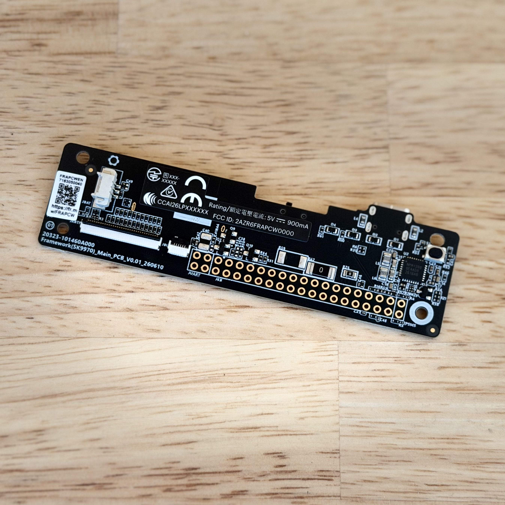
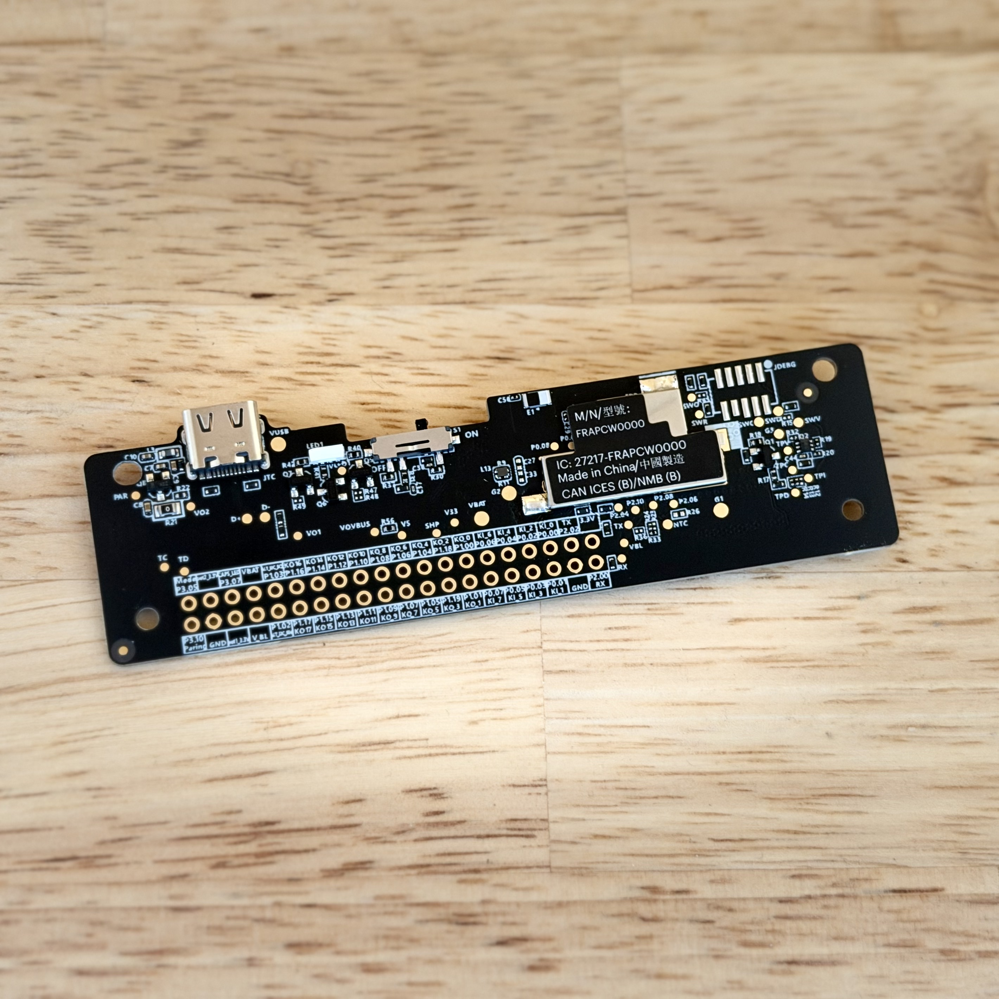

# Control Board

The Control Board is the module at the core of the Framework Wireless Touchpad Keyboard, built around the Nordic nRF54LM20A wireless SoC. It is designed to be reused by keyboard makers and DIYers.

> [!NOTE]
> This is preliminary information for the current prototype. Everything is subject to change.

| Front | Back |
| --- | --- |
|  |  |

Full resolution photos: [front](Assets/front.jpeg), [back](Assets/back.jpeg)

## CAD

- [ControlBoard.stp](ControlBoard.stp)

## Schematic and pinout

| File | Format |
| --- | --- |
| [Overview](Schematic/Overview.png) | PNG |
| [nRF54LM20A](Schematic/nRF54LM20A.png) | PNG |
| [Touchpad and keyboard matrix](Schematic/TouchpadKBMatrix.png) | PNG |
| [FFC](Schematic/FFC.png) | PNG |
| [LED](Schematic/LED.png) | PNG |
| [Test points](Schematic/TestPoints.png) | PNG |
| [Components](Schematic/Components.png) | PNG |
| [Power management and USB input](Schematic/PowerManagementUSBInput.pdf) | PDF |
| [Pinout](Schematic/Pinout.pdf) | PDF |
